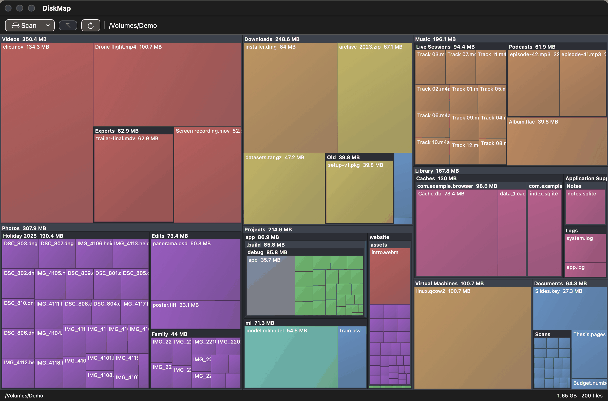
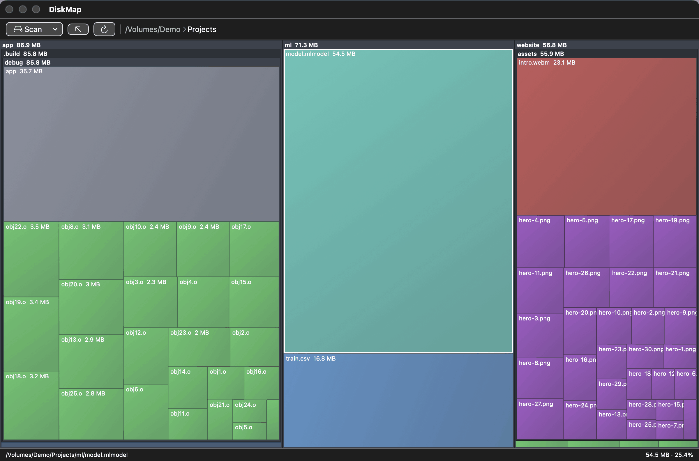

# DiskMap

A fast, native macOS disk-usage visualiser. Scan a folder, your home directory or
the whole disk and see every file and folder as a nested, squarified treemap,
sized by how much space it takes up and coloured by file type.



## What it's for

When your disk is filling up and you don't know why. One scan shows where the
space actually goes, so the biggest offenders stand out at a glance: forgotten
videos and screen recordings, old installers and archives in Downloads, app
caches and logs under `~/Library`, build folders and virtual machine images.
Zoom into a folder to see what's inside it, then reveal, open or move items to
the Trash straight from the map. Nothing is deleted outright: Trash is the only
destructive action, and it asks first, so anything removed can be restored.



## Features

- **Fast scanning.** Uses `getattrlistbulk` to read a whole directory per syscall,
  and spreads folders across a shared work queue.
- **Nested treemap.** Folders are drawn with their children inside them.
  Double-click to zoom in; press Esc to go up a level.
- **Colour by type.** Images, video, audio, archives, documents, code, binaries,
  disk images and caches each get their own hue.
- **Actions.** Right-click any tile to reveal it in Finder, open it, copy its path
  or move it to the Trash. Trashing shows the full path and size and asks for
  confirmation, and refuses if the item has changed since the scan.
- **Status bar.** Hover or click a tile to see its path, size, share of the current
  view and (for folders) file count.
- Stays on one volume, skips symlinks, and skips cloud-storage mounts
  (`~/Library/CloudStorage`).

## Requirements

- macOS 13 or later
- Swift 5.9+ (Xcode 15 or the Command Line Tools)

## Build

```sh
./make_app.sh
```

This builds a release binary and wraps it in an ad-hoc signed `DiskMap.app` next
to the script. You can also run it directly with `swift run`.

For complete results when scanning the whole disk, grant the app Full Disk Access
in System Settings → Privacy & Security. The app is only ad-hoc signed, so macOS
treats each rebuild as a new app: re-grant Full Disk Access after every rebuild
(remove the old entry and add the new `DiskMap.app`).

## Project layout

| File | Purpose |
| --- | --- |
| `Scanner.swift` | Multithreaded `getattrlistbulk` scanner |
| `Node.swift` | File/folder tree model |
| `Treemap.swift` | Squarified layout (Bruls et al.) and colour palette |
| `Model.swift` | App state, navigation and file actions |
| `ContentView.swift` | SwiftUI interface and Canvas rendering |
